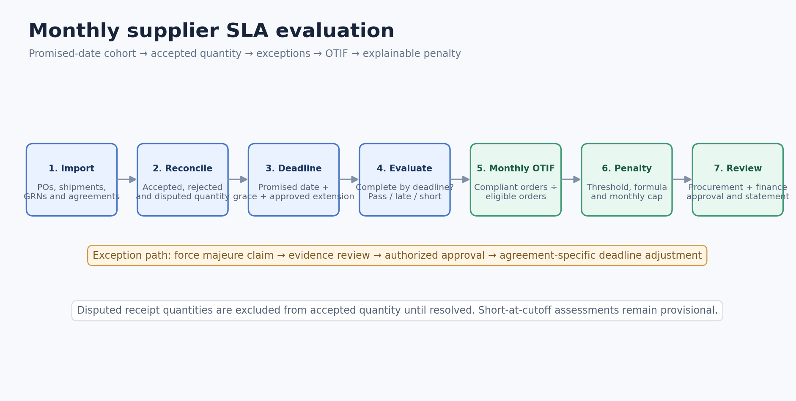
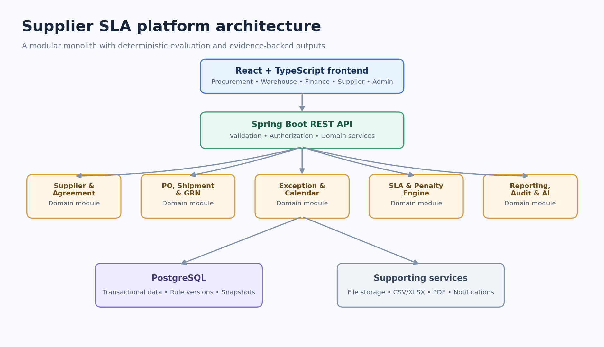
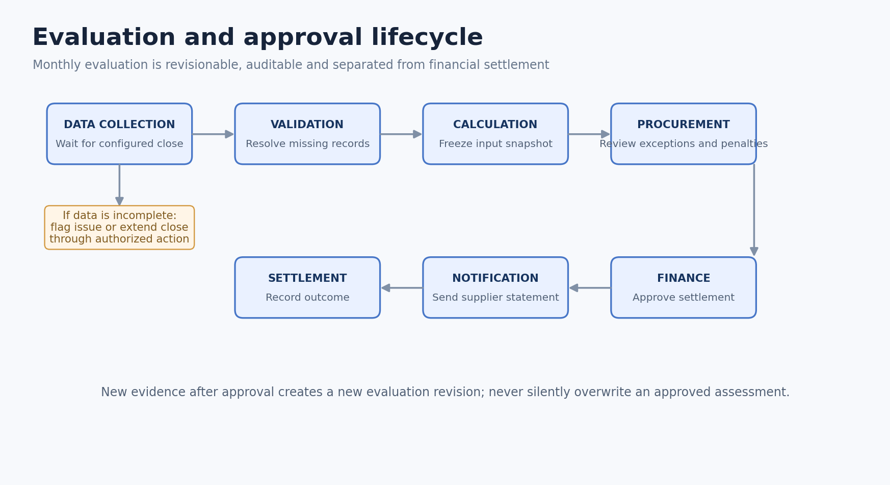
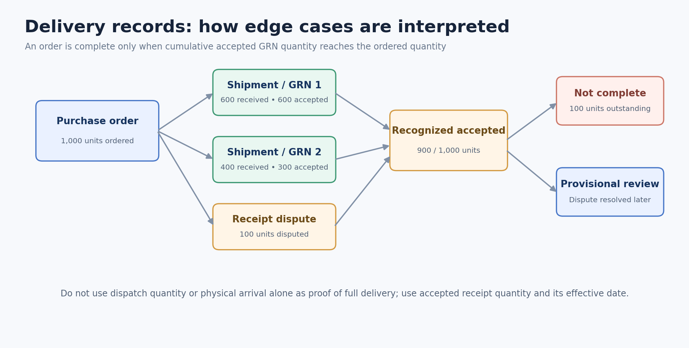
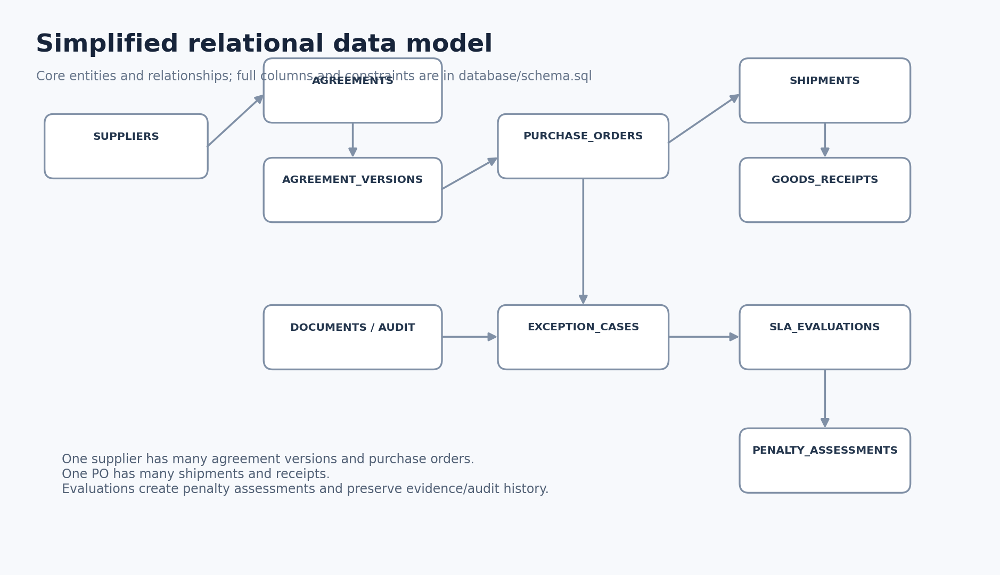

# Supplier SLA Compliance & Penalty Management Platform

A full-stack MVP starter for evaluating supplier delivery performance, applying configurable Service Level Agreement (SLA) rules, and producing explainable penalty assessments.

The platform brings purchase orders, split shipments, goods receipts, exceptions, supplier agreements, OTIF calculations, and penalty rules into one auditable workflow.

> **Project status:** MVP starter / educational implementation. The included dashboard and demo API use illustrative seeded data. The PostgreSQL schema is provided as a foundation; the current demo evaluation endpoint uses in-memory sample data. Do not use demo calculations for real supplier deductions without implementing and validating the complete contract-specific workflows.

---

## Contents

- [What problem does it solve?](#what-problem-does-it-solve)
- [Key capabilities](#key-capabilities)
- [How the system works](#how-the-system-works)
- [Architecture](#architecture)
- [Technology stack](#technology-stack)
- [Repository structure](#repository-structure)
- [Getting started](#getting-started)
- [Demo API](#demo-api)
- [Business rules](#business-rules)
- [Example scenarios](#example-scenarios)
- [Database model](#database-model)
- [Security and governance](#security-and-governance)
- [Roadmap](#roadmap)
- [Contributing](#contributing)
- [License](#license)

---

## What problem does it solve?

Supplier agreements commonly require a high percentage of orders to arrive **on time and in full (OTIF)**. Real delivery records are rarely straightforward:

- One purchase order may arrive in multiple shipments.
- A shipment may be partially accepted or disputed at goods receipt.
- A force-majeure event may justify a contractual deadline extension.
- Holidays and grace periods can affect date interpretation.
- Each supplier may have a different penalty formula and monthly cap.
- Procurement teams need to explain exactly how each penalty was calculated.

This platform is designed to turn those records and agreement rules into consistent, reviewable decisions.

## Key capabilities

| Capability | Description |
|---|---|
| Supplier and agreement management | Store supplier profiles and versioned SLA terms |
| Purchase order tracking | Track order value, quantity, promised date and supplier |
| Split shipment tracking | Link multiple shipments to one purchase order |
| GRN reconciliation | Distinguish physically received, accepted, rejected and disputed quantities |
| OTIF evaluation | Evaluate orders in the month of their promised date |
| Exception management | Review force-majeure claims and receipt disputes |
| Penalty calculation | Apply supplier-specific formulas and monthly caps |
| Explainable assessments | Show deadlines, quantities, delays, formula and evidence |
| Monthly reporting | Summarize supplier performance and recommended penalties |
| AI extension points | Support future contract extraction, anomaly detection and explanation assistance |

## How the system works



1. Load supplier agreements and purchase orders.
2. Match shipment and goods-receipt records to each order.
3. Calculate the contractual grace deadline.
4. Reconcile accepted quantities and approved exceptions.
5. Evaluate each order against its adjusted deadline.
6. Calculate monthly OTIF for the promised-date cohort.
7. If OTIF is below the configured threshold, calculate eligible order penalties.
8. Apply the monthly cap and send assessments for human approval.
9. Generate an evidence-backed report for procurement, finance and suppliers.

## Architecture



The starter uses a **modular monolith**: a single Spring Boot application organized around business capabilities. This keeps the initial deployment manageable while preserving boundaries that can be separated later if needed.

### Main application areas

- Identity and access management
- Supplier management
- Agreement management
- Purchase order management
- Shipment and goods-receipt management
- Exception and calendar management
- SLA evaluation engine
- Penalty engine
- Reporting and approval
- AI integration points

### Evaluation lifecycle



## Technology stack

| Layer | Technology |
|---|---|
| Frontend | React + TypeScript + Vite |
| UI styling | CSS, Lucide React icons |
| Backend | Java 21 + Spring Boot 3 |
| API validation | Jakarta Bean Validation |
| Database foundation | PostgreSQL 16 |
| Schema | SQL |
| Container | Docker Compose |
| Testing | JUnit 5, Spring Boot Test |
| Build | Maven |
| Future document processing | Apache POI, PDFBox/OpenPDF |
| Future AI integration | Provider-independent service interface |

## Repository structure

```text
supplier-sla-platform/
├── backend/
│   ├── pom.xml
│   └── src/
│       ├── main/java/com/example/suppliersla/
│       │   ├── api/
│       │   ├── demo/
│       │   ├── engine/
│       │   └── SupplierSlaApplication.java
│       ├── main/resources/application.yml
│       └── test/
├── frontend/
│   ├── src/
│   │   ├── App.tsx
│   │   ├── main.tsx
│   │   └── styles.css
│   ├── package.json
│   └── vite.config.ts
├── database/
│   └── schema.sql
├── docs/
│   ├── API.md
│   ├── BUSINESS_RULES.md
│   └── images/
├── templates/
│   ├── supplier-template.csv
│   ├── agreement-template.csv
│   ├── purchase-orders-template.csv
│   ├── shipments-template.csv
│   └── goods-receipts-template.csv
├── docker-compose.yml
├── .gitignore
└── README.md
```

## Getting started

### Prerequisites

- Java 21
- Maven 3.9+
- Node.js 20+
- npm
- Docker Desktop (optional; needed only to start the provided PostgreSQL container)

Check your versions:

```bash
java -version
mvn -version
node -version
npm -version
docker --version
```

### 1. Clone the repository

```bash
git clone https://github.com/<your-username>/supplier-sla-platform.git
cd supplier-sla-platform
```

### 2. Start PostgreSQL

```bash
docker compose up -d postgres
```

The local development database is configured as:

| Setting | Value |
|---|---|
| Host | `localhost` |
| Port | `5432` |
| Database | `supplier_sla` |
| Username | `supplier_sla` |
| Password | `supplier_sla_dev` |

These are development-only credentials. Replace them with environment-based secrets before deployment.

### 3. Run the backend

Open a terminal:

```bash
cd backend
mvn spring-boot:run
```

Backend base URL: `http://localhost:8080`

Health check:

```bash
curl http://localhost:8080/api/v1/health
```

### 4. Run the frontend

Open another terminal from the repository root:

```bash
cd frontend
npm install
npm run dev
```

Frontend URL: `http://localhost:5173`

Vite proxies `/api` requests to the backend at `http://localhost:8080`.

### 5. Build the frontend

```bash
cd frontend
npm run build
```

### 6. Run backend tests

```bash
cd backend
mvn test
```

## Demo API

Base path: `/api/v1`

| Method | Endpoint | Purpose |
|---|---|---|
| GET | `/health` | API health check |
| GET | `/demo/monthly-report?month=2026-10` | October 2026 sample report |
| GET | `/demo/orders` | Sample purchase orders |
| GET | `/demo/orders/{orderNumber}/explanation` | Explain one sample order |
| POST | `/evaluations/preview` | Evaluate a supplied sample payload |

### Evaluation preview request

```json
{
  "supplierName": "Example Resin Supplier",
  "month": "2026-10",
  "otifTargetPercent": 95,
  "graceDays": 2,
  "monthlyOrderValue": 700000,
  "monthlyCapPercent": 5,
  "penaltyRatePerDay": 0.005,
  "penaltyBasis": "FULL_PO_VALUE",
  "orders": [
    {
      "orderNumber": "PO-1001",
      "orderValue": 100000,
      "orderedQuantity": 1000,
      "promisedDate": "2026-10-07",
      "approvedExtensionDays": 0,
      "receipts": [
        {
          "receiptDate": "2026-10-09",
          "acceptedQuantity": 1000,
          "disputedQuantity": 0
        }
      ]
    }
  ]
}
```

Example with curl:

```bash
curl -X POST http://localhost:8080/api/v1/evaluations/preview \
  -H "Content-Type: application/json" \
  -d @evaluation-request.json
```

See [`docs/API.md`](docs/API.md) for details.

## Business rules

The baseline rules captured from the requirements are:

1. **Monthly cohort:** an order belongs to the month containing its promised delivery date.
2. **Grace period:** two calendar days; the final grace day is inclusive.
3. **Completion:** 100% of the ordered quantity must be accepted through goods receipt.
4. **Partial deliveries:** the supplier agreement determines the penalty basis.
5. **Short at cutoff:** classify as `SHORT_AT_CUTOFF`; calculate a provisional assessment using outstanding quantity where supported by the agreement.
6. **Disputed receipts:** disputed quantities do not count as accepted until resolved.
7. **Force majeure:** an authorized approver must approve the claim; the agreement defines eligible days and extension limits.
8. **Holiday calendars:** supplier and receiving-location calendars are distinct. The baseline grace period remains calendar-day based.
9. **Threshold:** penalty activation occurs only when the exact monthly OTIF ratio is strictly below 95%. Exactly 95% does not activate penalties.
10. **Penalty cap:** calculate eligible penalties and apply the agreement-configured cap and cap basis.
11. **Month-end close:** evaluation runs after a configurable data-closing period.
12. **Auditability:** re-evaluations create revisions; previously approved calculations must not be silently overwritten.

Read [`docs/BUSINESS_RULES.md`](docs/BUSINESS_RULES.md) before changing calculation logic.

### Important contract-specific configuration

The following cannot safely be generalized across all suppliers:

- Whether the penalty base is the full PO value or delayed quantity value.
- Daily versus fixed penalty rate.
- Monthly cap basis and whether the cap is supplier-wide or agreement-specific.
- Treatment of overlapping force-majeure events.
- Final reconciliation of provisional short-delivery assessments.
- Whether a threshold breach activates penalties for all failed orders or only selected failures.

The system should use approved, versioned agreement configuration for these terms.

## Example scenarios



| Scenario | Expected baseline decision |
|---|---|
| Complete receipt on promised date | Compliant |
| Complete receipt on final grace day | Compliant |
| Complete receipt after grace deadline | Late |
| Split shipments complete within grace | Compliant |
| Split shipments complete after grace | Late |
| Quantity still outstanding at cutoff | Provisional short assessment |
| Receipt quantity disputed | Excluded from accepted quantity |
| Approved force majeure claim | Apply agreement-specific extension |
| Rejected force majeure claim | No extension |
| Monthly OTIF exactly 95% | No penalty activation |
| Monthly OTIF below 95% | Activate eligible penalties |

## Database model

The PostgreSQL schema is in [`database/schema.sql`](database/schema.sql).



The schema includes suppliers, agreement versions, SLA and penalty rules, purchase orders, shipments, goods receipts, exception cases, evaluation batches, order-level evaluations, penalty assessments and audit events.

**Current implementation boundary:** the schema is supplied as a database foundation. The included demo endpoints currently read in-memory sample data; repository/entity persistence, migrations, transactional workflows and production authentication still need to be completed.

## Security and governance

Before production use, implement and verify:

- JWT authentication and role-based access control.
- Supplier-level data isolation enforced on the backend.
- Separate procurement and finance approval permissions.
- Immutable agreement versions and evaluation snapshots.
- Idempotent monthly evaluation runs.
- Audit history for overrides, approvals and recalculations.
- Secure document storage and malware/file-type validation.
- Secrets supplied through environment variables or a secret manager.
- Database backups, retention and disaster recovery.
- Supplier notification and dispute-response controls.

## Roadmap

- [x] Initial project structure and local development setup
- [x] Demo dashboard and seeded October 2026 scenario
- [x] Basic deterministic evaluation preview endpoint
- [x] PostgreSQL schema foundation
- [x] Initial boundary-condition tests
- [ ] Persist suppliers, agreements, POs, shipments and GRNs
- [ ] Complete agreement versioning and rule configuration
- [ ] Implement GRN dispute resolution and receipt reversals
- [ ] Implement contract-aware force-majeure approval and calendar logic
- [ ] Implement production penalty formula catalog and monthly cap aggregation
- [ ] Add authentication, authorization and supplier data isolation
- [ ] Add import validation and durable document storage
- [ ] Add approval, notification and PDF/Excel reporting workflows
- [ ] Add AI extraction with human verification
- [ ] Add end-to-end, security and load tests

## Contributing

1. Create a feature branch.
2. Keep business rules in domain services rather than controllers.
3. Add tests for every calculation change.
4. Never change an approved assessment in place; create a revision.
5. Update the API and business-rule documentation when behavior changes.
6. Open a pull request with a summary and test evidence.

See [`CONTRIBUTING.md`](CONTRIBUTING.md).

## License

This project is provided under the MIT License. See [`LICENSE`](LICENSE).
